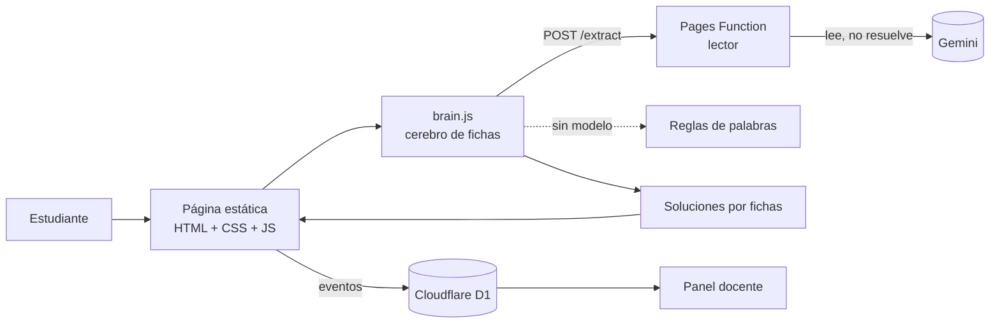

# Chaski

Mensajero-IA que solo sabe lo que el estudiante le enseña. Si le explicas bien, resuelve bien. Si le explicas mal o dejas huecos, se confunde y se equivoca, siempre con total seguridad. El estudiante tiene que revisarlo, atraparlo y corregirlo. Entrena el hábito de verificar y de explicar con palabras propias.

Nació para la Grieta 02, «Aprender sin pensar», del DSC Hack 2026. Es un **piloto exploratorio**: no prueba efecto ni evalúa con nota.

**Demo:** <https://chaski.pages.dev> · **Panel docente:** <https://chaski.pages.dev/panel.html> · **Pitch deck:** [docs/Chaski-pitch-deck.html](docs/Chaski-pitch-deck.html) (descárgalo y ábrelo en el navegador)

## Índice

[Problema y solución](#problema-y-solución) · [Evidencia](#evidencia-y-por-qué-crece) · [Usuario y negocio](#usuario-cliente-y-caso-de-negocio) · [Demo y uso](#demo-desplegada) · [Qué funciona y qué no](#funcionalidades-implementadas) · [Arquitectura y tecnologías](#arquitectura-y-tecnologías) · [Cómo ejecutarlo](#instrucciones-de-ejecución) · [Pruebas](#pruebas) · [Datos y privacidad](#datos-y-privacidad) · [Límites](#alcance-y-límites)

## Problema y solución

**Problema (Grieta 02, «Aprender sin pensar»).** Un estudiante que le pide la respuesta a una IA obtiene la tarea hecha sin haber pensado. La IA responde siempre con seguridad, aunque se equivoque, y quien no revisa no se entera. Se pierden dos hábitos: **explicar con palabras propias** y **verificar** lo que dice una máquina. La ilusión de aprender es el riesgo central: la respuesta es fluida, se entiende al leerla y parece que ya se sabe.

**Solución.** Se invierten los roles: el estudiante es quien enseña. Chaski, un mensajero inca, solo sabe lo que se le explicó. Si la explicación es buena, resuelve bien. Si es incompleta o equivocada, comete justo el error que esa explicación produce, y lo presenta con total seguridad. El estudiante tiene que detectarlo («¡Alto, Chaski!»), señalar el paso donde falla y corregirlo. Al final, el juego le muestra por qué se equivocó Chaski.

**Por qué no es de los intentos que el reto da por insuficientes.**

| Intento que «no alcanza» | Chaski |
|---|---|
| Chatbot que da respuestas | No responde ni da la solución: el estudiante enseña y revisa |
| Detector de textos hechos con IA | No acusa. Marca señales (pegado, texto copiado) y se las muestra al docente como señal, no como juicio |
| ChatGPT con otro nombre y otro color | El modelo solo **lee** la explicación. Quien resuelve son fichas deterministas, y cada error se rastrea hasta lo que el estudiante enseñó |

**Qué se mide.** Si el estudiante atrapa los errores, cuántas falsas alarmas da, qué ideas enseñó bien, si repite lo anterior en vez de usar palabras propias y cómo responde a preguntas nuevas (ver [Métricas del piloto](#métricas-del-piloto)). El docente lo ve en un panel por clase.

> **Evidencia de uso:** **una docente y un estudiante de secundaria probaron el piloto**; el registro está en la carpeta de evidencias del DSC Hack (Drive, «G - LLM»). Es una prueba muy pequeña: **todavía no se probó con una clase completa**. Lo que se comprobó con pruebas automáticas está en [Funcionalidades implementadas](#funcionalidades-implementadas).

## Evidencia y por qué crece

| Dato | Fuente | Ojo |
|---|---|---|
| **Matemática, PISA 2025:** Perú 382 puntos (9 menos que en 2022). Solo **30 %** de los estudiantes de 15 años llega al nivel mínimo, así que cerca de **70 %** queda por debajo. OCDE: 35 %. América Latina (13 países): 76 % | PISA 2025 (OCDE, 08/09/2026), vía Forbes Perú, Cámara de Comercio de Lima y blog del Banco Mundial | Cifras de prensa y del Banco Mundial, **no leímos el informe de la OCDE/Minedu**. El 70 % es el complemento del 30 %. No usamos el puesto en el ranking porque los medios no coinciden |
| En PISA 2022 el nivel mínimo en matemática lo alcanzó 34 % de los estudiantes peruanos (promedio OCDE: 69 %) | Nota país PISA 2022, OCDE | Citada de la ficha de la OCDE vista en buscador; verificar |
| Los riesgos de la IA generativa para los estudiantes superan hoy sus beneficios | Brookings (Burns, Winthrop et al., ene 2026; más de 500 personas en 50 países), según el documento del reto | No leímos el informe completo |
| La evidencia sobre IA en educación del Perú casi no cubre secundaria | Búsqueda académica LeapSpace (31/10/2026) | Es ausencia en lo que se buscó, no prueba de que no exista |
| Las ganancias de aprendizaje dependen de cómo se usa la IA, no de que se use | Metaanálisis de estudios experimentales (Han et al. 2025; Deng et al. 2025) y estudios con escolares de otros países | Evidencia de otros contextos |

**Por qué PISA importa a Chaski:** los tres temas del juego son matemática de secundaria (proporciones, porcentajes y ecuaciones), justo donde el Perú rinde peor y cae. Con ese punto de partida, una IA que resuelve la tarea sin que el estudiante piense agrava el problema. Sobre matemática con IA en secundaria peruana, la evidencia local es escasa: hay un piloto de chatbot en un colegio de Lima (Iglesias et al. 2025) y una correlación autorreportada entre uso de IA y pensamiento crítico en Los Olivos (n = 288, Rho = 0,78), que **no mide aprendizaje**. Los ensayos con medición independiente vienen de otros países (Bastani et al., por verificar): la IA sin salvaguardas dañó el aprendizaje. Por eso Chaski obliga a producir antes de recibir ayuda.

**No hay una cifra de uso de IA en escolares peruanos** y no la inventamos: es un pendiente.

**Por qué crece hacia 2036:** el acceso a la IA solo aumenta, pero las tareas y los exámenes siguen diseñados para un mundo sin ella; en la búsqueda no apareció una guía oficial para secundaria; y el docente no alcanza a mediar solo (22 % de los docentes de secundaria tiene 55 años o más, según el reto).

**Lo que entendimos y otros no:** el problema no es el acceso a la IA ni el plagio, sino la **ilusión de aprender**. Un detector no la arregla, porque quien no copió igual puede no haber aprendido. Chaski no combate la IA: la usa para pedir al estudiante que produzca la explicación y que verifique a una máquina.

**Referentes.** Aprender enseñando (efecto protégé), autoexplicación y *Betty's Brain* (Biswas et al., por verificar), y *Boots Interview* de Boot.dev, donde el tutor pregunta y el estudiante produce antes de recibir ayuda.

Detalle, fuentes con enlaces, el problema del «puente» con otro chatbot y los pendientes de verificación: [docs/problema-y-evidencia.md](docs/problema-y-evidencia.md).

## Usuario, cliente y caso de negocio

- **Usuario:** estudiante de secundaria. Es donde los hábitos de estudio aún se forman. Contenido en español del Perú, con soles.
- **Cliente (hipótesis):** el colegio, que obtiene un panel con qué ideas se dejan pasar. **Falta definir quién decide la compra** (dirección o coordinación académica).
- **Modelo (hipótesis, sin validar):** licencia anual por colegio con el panel incluido; en el futuro, versión gratuita con funciones de pago para el estudiante. La hipótesis más débil es que el colegio pague, y la primera por probar con docentes y directivos.
- **Costo de operar:** el sitio corre en el plan gratuito de Cloudflare Pages; la lectura con el modelo ligero cuesta centavos o menos por lectura (estimado, no medido), con topes de uso por IP y por día. Un tema nuevo es un archivo de contenido, sin tocar el juego.
- **Hoja de ruta:** probar con una clase completa y con más docentes; «Chaski curioso» (repregunta como alumno); «Chaski olvida» a los 3 o 7 días para medir retención; conversación por voz con Chaski; más temas.

## Temas

El docente elige el tema y comparte un enlace. Hay tres paquetes de matemática de secundaria:

| Tema | Ideas que Chaski puede aprender (o no) |
|---|---|
| Proporciones | multiplicar y no sumar · cada dato con su pareja · si una sube, la otra baja |
| Porcentajes | el porcentaje es una parte del total · descuento y aumento · si te dan la parte, busca el total |
| Ecuaciones de primer grado | lo que suma pasa restando · el paréntesis se reparte · primero suma o resta, después divide |

El docente decide en qué grado usa cada tema. Para agregar otro tema, ver [docs/contenido-de-temas.md](docs/contenido-de-temas.md).

## Cómo se juega

1. **Enseñar.** Chaski plantea la pregunta en una placa de piedra y el estudiante responde en una tablilla de arcilla, escribiendo o **dictando por voz** (el texto cae en la tablilla y se edita antes de enviar). No es un chat: al enviar, el texto vuela y ata un nudo en la cuerda de Chaski. Tocar un nudo muestra lo que se enseñó. Después puede agregar más lecciones.
2. **El cerebro.** Chaski cuenta lo que entendió. Un modelo de lenguaje lee la explicación y rellena tres fichas (una por idea): bien, mal o ausente, con una cita del estudiante como evidencia.
3. **El camino.** Chaski resuelve 6 problemas, uno por tambo del Camino Inca, usando solo sus fichas. Con la ficha bien acierta. Si falta o está mal, comete el error típico de ese tema. Cuando todo está bien enseñado, igual comete un descuido de cálculo, para que haya algo que revisar.
4. **Revisar.** El estudiante elige «Dejar pasar» o «¡Alto, Chaski!». Si lo detiene, toca el nudo del quipu donde está el error y teclea la respuesta correcta. El juego no dice si acertó hasta el final de la ronda.
5. **Preguntas de Chaski.** Tres preguntas numéricas con otros números y una pregunta libre («dímelo con otro ejemplo»).
6. **Rendición de cuentas.** Sellos por problema, el mensaje que llegó al Cusco con los errores que no se corrigieron, y por qué se equivocó Chaski.
7. **Enseñar de nuevo** (opcional, una vez) y **cierre** con el resumen.

## Demo desplegada

**<https://chaski.pages.dev>** (celular o computadora, sin instalar nada).

1. Abre el **[panel docente](https://chaski.pages.dev/panel.html)**, elige un tema y copia el enlace para estudiantes. También sirve abrir directamente `https://chaski.pages.dev/?tema=porcentajes&clase=3A` (temas: `proporciones`, `porcentajes`, `ecuaciones`).
2. Escribe un apodo y un código de clase, y marca la casilla del adulto responsable. No pidas ni escribas nombres reales.
3. Enséñale a Chaski respondiendo sus dos preguntas. Prueba **explicar mal a propósito** (por ejemplo, «si compras el doble, pagas dos más») y mira cómo se equivoca.
4. En cada problema elige «Dejar pasar» o «¡Alto, Chaski!». Al final, la rendición de cuentas muestra qué errores atrapaste y por qué falló Chaski.
5. Vuelve al panel y carga los datos de la clase.

Si el modelo de lenguaje no responde (sin conexión, sin cuota o tarda más de 12 segundos), Chaski lee la explicación con **reglas de palabras**. El juego sigue funcionando, pero entiende menos formas de explicar.

## Funcionalidades implementadas

| Funciona | Cómo se comprobó |
|---|---|
| Tres temas de matemática de secundaria, con 6 problemas cada uno y su error típico | Cuentas verificadas de forma independiente en pruebas automáticas |
| Cerebro de fichas: bien, mal o ausente por idea, con cita como evidencia | Pruebas automáticas con reglas y con un modelo simulado |
| Errores de Chaski atribuidos a lo que se enseñó, y un descuido de cálculo si todo está bien enseñado | Pruebas automáticas |
| Revisión (dejar pasar o detener, señalar el paso, corregir), preguntas de seguimiento y rendición de cuentas | Jugador simulado en el navegador, vista móvil de 375 × 812 |
| Lectura con modelo de lenguaje (Gemini) y respaldo con reglas de palabras | Servidor probado con un modelo simulado; el sitio está desplegado |
| Panel docente: enlace por tema y clase, métricas, carga desde dispositivo, archivo JSON o base de datos, borrado de datos de una clase | Pruebas del servidor y a mano |
| Guardado de partidas de varios dispositivos (Cloudflare D1) | Pruebas del servidor |
| Aviso de uso de IA, política de privacidad, términos y autorización imprimible para tutores | Pruebas del empaquetado |
| Tope de uso por IP y tope diario en el servidor | Pruebas del servidor |
| Dictado por voz (Whisper en Workers AI): el texto cae en la tablilla y se edita antes de enviar; el docente puede apagarlo con `voz=0` en el enlace | Pruebas del servidor y del núcleo; falta probar en celulares reales |

**Limitaciones actuales:** solo lo probaron una docente y un estudiante; falta probarlo con una clase completa y en celulares reales de gama baja. No se mide aprendizaje ni retención (ver [Alcance y límites](#alcance-y-límites)). La interfaz no tiene pruebas automáticas. Detalle por requerimiento en [docs/requerimientos.md](docs/requerimientos.md).

## Arquitectura y tecnologías



| Capa | Tecnología |
|---|---|
| Juego y panel | HTML, CSS y JavaScript sin dependencias ni compilación; dibujo en SVG hecho en código |
| Lector con el modelo | TypeScript, `zod`, API de Gemini vía `fetch`; Cloudflare Pages Function (también corre como Worker) |
| Datos | Cloudflare D1 (opcional); alternativa con Apps Script y hoja de Google |
| Hosting | Cloudflare Pages |

Decisiones técnicas clave:

- **El modelo solo lee; las fichas resuelven.** Un modelo que debe «olvidar» lo que sabe resuelve bien aunque se le enseñe mal. Por eso solo clasifica la explicación en fichas (con una cita que debe aparecer en el texto del estudiante) y las soluciones se calculan de forma determinista. Los errores no se generan: se eligen de una lista por problema.
- **Nunca se detiene por el modelo.** Si falla, tarda o responde algo inválido, se usan las reglas de palabras.
- **Seguridad del texto del estudiante.** Lista cerrada de temas, el texto se trata como dato y no como instrucción, y se inserta siempre como texto, nunca como HTML.
- **Sin cuentas.** Un apodo y un código de clase; el tema va en el enlace.

Más detalle en [docs/arquitectura.md](docs/arquitectura.md).

## Instrucciones de ejecución

El juego es una página estática:

```bash
python -m http.server 5190
```

- Juego: `http://localhost:5190/` (o `?tema=porcentajes&clase=3A`).
- Panel docente: `http://localhost:5190/panel.html`.

Así corre con reglas de palabras. Para la lectura con el modelo y la base de datos hace falta Cloudflare: ver [Despliegue](#despliegue).

## Pruebas

```bash
npm ci                    # instala zod (una vez)
npm test                  # núcleo (39), figuras (9), dibujo (7), empaquetado del sitio (20) y servidor (58)
npm run test:core         # solo el núcleo
npm run test:figures      # solo las figuras de los problemas (9)
npm run test:scenery      # solo el dibujo (7)
npm run test:site         # solo el empaquetado del sitio (20)
npm run test:worker       # solo el servidor (58)
```

Requiere **Node 22.18 o superior** (el servidor se prueba en TypeScript sin compilar; en versiones anteriores de Node 22 falla con `Unknown file extension ".ts"`).

## Despliegue

Guía paso a paso para Cloudflare: [docs/despliegue.md](docs/despliegue.md).

**Todo en un proyecto de Cloudflare Pages.** El juego y el panel son archivos estáticos (`npm run build:site` arma `dist/`) y la lectura con el modelo es una Pages Function en [functions/](functions/extract.ts) que responde en `/extract`, en el mismo sitio. No hay Worker aparte, ni CORS, ni direcciones que copiar: solo se agrega el secreto `GEMINI_API_KEY` en el proyecto. El mismo código corre también como [Worker independiente](worker/README.md).

**Guardar datos de varios dispositivos (opcional):** la base de datos D1 del propio proyecto de Pages, en [functions/events.ts](functions/events.ts), con el esquema en [db/schema.sql](db/schema.sql). Pasos en [docs/despliegue.md](docs/despliegue.md#5-guardar-los-datos-de-los-estudiantes-opcional). Sin esto, los datos quedan en el navegador de cada estudiante y el panel los lee de ese dispositivo o de un archivo JSON. También se puede usar un Apps Script que escribe en una hoja de Google ([apps-script/](apps-script/README.md)).

## Datos y privacidad

El detalle para estudiantes y familias está en la [política de privacidad](privacidad.html) y los [términos de uso](terminos.html) del sitio. Para jugar con menores hay una [autorización imprimible para madres, padres y tutores](consentimiento.html). El correo de contacto que muestran esas páginas se fija al empaquetar con `CONTACT_EMAIL`.

- Solo se piden un **apodo** y un **código de clase**. No se piden nombre ni datos personales.
- Los textos que escribe el estudiante se guardan (en su dispositivo y, si se configura, en la base de datos o en la hoja). Cada campo recuerda no escribir datos personales. El docente puede borrar de la base los datos de su clase desde el panel.
- Cuando se usa el modelo, el texto del estudiante se envía a un servicio externo (Google Gemini) a través del servidor intermedio. Los términos de la API de Gemini restringen su uso en clientes dirigidos a menores de 18 años; para aplicarlo con menores, el juego funciona sin modelo, con reglas de palabras (ver [docs/despliegue.md](docs/despliegue.md#privacidad-y-datos)).
- **Dictado por voz (opcional):** el audio viaja a Cloudflare Workers AI (Whisper), que lo pasa a texto y no se guarda. Solo queda registro de si se dictó, cuánto se grabó y si se editó el texto. El docente puede apagarlo con `voz=0` en el enlace.
- Con menores, siempre con un adulto responsable presente. El permiso de tutores y el tiempo de conservación de los datos corresponden a la institución o al docente que aplique el piloto (ver [docs/requerimientos.md](docs/requerimientos.md)).

## Métricas del piloto

| Métrica | Cómo se calcula |
|---|---|
| Detección | errores marcados / errores que Chaski realmente cometió |
| Falsas alarmas | soluciones correctas marcadas como error / soluciones correctas |
| Ideas bien enseñadas | fichas del cerebro final que quedaron «bien» (de 3) |
| Dependencia (exploratorio, 0 a 1) | promedio de: errores no detectados, preguntas de seguimiento falladas y textos con originalidad débil |

Como los errores salen de lo enseñado, cada estudiante tiene una mezcla distinta de errores y de soluciones correctas. La discriminación (detección menos falsas alarmas) sigue siendo comparable.

`ANNOUNCE_ERRORS` en `js/config.js`: en `true`, Chaski avisa que se equivocará si lo enseñan mal. En `false`, no lo dice y se mide confianza a ciegas. Anunciarlo infla la detección.

## Estructura del repositorio

```
index.html, panel.html     Juego y panel docente
privacidad.html, terminos.html, consentimiento.html, acerca.html
                           Política de privacidad, términos de uso, autorización imprimible para tutores y acerca de
css/                       game.css (juego) y panel.css (panel)
js/                        content, core, brain, figures (gráficos de los problemas), scenery (paisaje y personaje), app, panel, config
tests/                     Pruebas del núcleo (sin dependencias)
worker/                    Lector con el modelo: lógica y pruebas (TypeScript), desplegable como Worker
functions/                 Pages Functions /extract (lectura con el modelo) y /events (base de datos): usan el código de worker/
db/                        Esquema SQL de la base de datos (Cloudflare D1)
apps-script/               Alternativa: guardado de eventos en una hoja de Google
scripts/, deploy/          Empaquetado del sitio y cabeceras para Cloudflare Pages
brand/                     Favicon e imagen para compartir por WhatsApp (ver brand/README.md)
mockup/                    Primeras exploraciones de diseño (A: noche, B: textil andino de día)
docs/                      Problema y evidencia, arquitectura, requerimientos y guía de contenido
```

Más detalle en [docs/arquitectura.md](docs/arquitectura.md).

## Alcance y límites

- **Piloto exploratorio.** Describe cómo enseñan y revisan los estudiantes. No hay examen final, día 2 ni pretest, así que no mide retención ni aprendizaje.
- **La señal de originalidad es heurística** y puede equivocarse con textos cortos o vocabulario muy común.
- **El índice de dependencia es exploratorio**, sin una escala validada.
- **Los topes de uso dependen de la base de datos.** Por IP y por día, solo se aplican con D1 enlazada; si la base falla, no se limita nada para no dejar sin juego a la clase. Además se restringe el origen (`ALLOWED_ORIGINS`).
- **Se explica con texto o dictado, no con dibujos.** En las pruebas con usuarios se señaló que explicar solo con texto es complicado: es lento y puede causar malentendidos con la IA. Por eso se agregó el dictado por voz, que todavía no se volvió a probar con usuarios. La explicación gráfica está propuesta en la [hoja de ruta](docs/problema-y-evidencia.md#8-hoja-de-ruta), no implementada.
- **Validación con usuarios mínima.** Lo probaron una docente y un estudiante (evidencia en el Drive del DSC Hack, «G - LLM»). No hay pruebas con una clase completa ni en celulares reales.
- **El modelo envía el texto del estudiante a un servicio externo** (Gemini). Con menores, ver [Datos y privacidad](#datos-y-privacidad).
- **Los dibujos son vectoriales hechos en código**, no ilustraciones profesionales, y el juego no tiene sonido.
