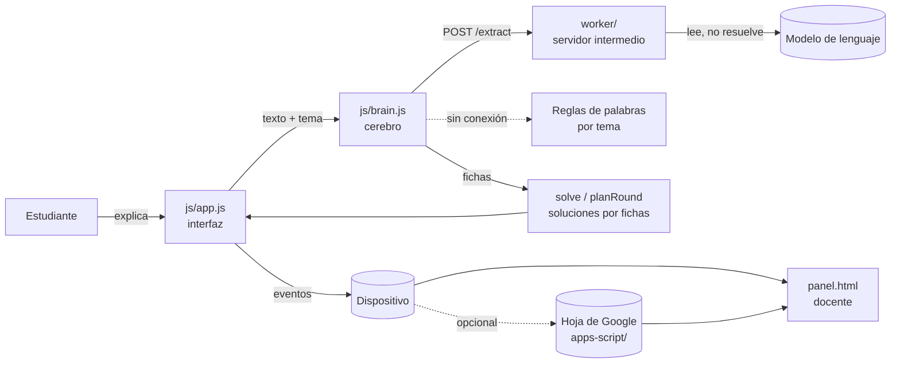

# Arquitectura

## Vista general



El juego es una página estática. No hay servidor propio salvo el opcional que lee la explicación con el modelo.

## Módulos

| Archivo | Responsabilidad | Depende de |
|---|---|---|
| `js/content.js` | Un paquete por tema: fichas, problemas con su solución correcta y su error típico, preguntas de seguimiento, reglas de palabras. `use(id)` activa un tema. | nada |
| `js/core.js` | Funciones puras: leer números, señal de originalidad, métricas por sesión, agrupación por estudiante. | nada |
| `js/brain.js` | Cerebro (fichas), solución por fichas, lectura de la explicación (servidor o reglas). | content, core |
| `js/scenery.js` | Dibujo: paisaje panorámico en tres momentos del día (amanecer, día, atardecer), Chaski con cinco estados de ánimo y la choza del tambo. Solo SVG, sin lógica de juego. | nada |
| `js/app.js` | Interfaz del juego: escenas, estado, registro de eventos. | content, core, brain, scenery |
| `js/panel.js` | Panel docente: elegir tema y enlace, cargar datos, cifras, ideas por retomar y tabla de estudiantes. | content, core, scenery |
| `js/config.js` | Direcciones y opciones editables. | nada |
| `functions/events.ts` | Pages Function que responde en `/events`: guarda, lee y borra los eventos en la base D1 enlazada como `DB`. Usa `handleEvents()` de `worker/src/events.ts`. | worker/ |
| `functions/extract.ts` | Pages Function que responde en `/extract` y llama a `handle()` de `worker/`. Es el camino por defecto en Cloudflare Pages. | worker/ |
| `worker/` | Servidor intermedio: valida, arma el prompt por tema, llama al modelo, sanea la respuesta. | API de Gemini (`fetch`), zod |
| `apps-script/Code.gs` | Alternativa a la base de datos: recibe eventos y los guarda en una hoja. | nada |

`content.js`, `core.js` y `brain.js` no usan el DOM, por eso se prueban en Node (`tests/core.test.js`).

## Decisiones de diseño

**El modelo solo lee; las fichas resuelven.** Un modelo que debe «olvidar» lo que sabe tiende a resolver bien aunque el estudiante haya enseñado mal. El modelo devuelve para cada ficha un estado (bien, mal, ausente) y una cita textual. Si la cita no aparece en lo que escribió el estudiante, la ficha vuelve a ausente. Las soluciones las calculan las fichas de forma determinista: cada error se atribuye a lo que se enseñó, y nunca se enseña algo falso por accidente.

**Los errores no se generan, se eligen.** Cada problema trae su solución correcta, su solución equivocada y, a veces, una con un descuido de cálculo. Ver [contenido-de-temas.md](contenido-de-temas.md).

**Siempre hay un descuido.** Si el estudiante enseña todo bien, Chaski comete un único error de cálculo en un problema con la ficha bien. Así todos practican verificar.

**Sin aviso durante la ronda.** El juego no dice si el estudiante acertó hasta el final, para que la medición sea limpia.

**Respaldo sin conexión.** Si el servidor falla, tarda más de 12 segundos o responde algo inválido, `brain.js` lee con las reglas de palabras del tema. El juego nunca se detiene por el modelo.

**El tema se elige por enlace.** `index.html?tema=porcentajes&clase=3A`. No hay cuentas ni base de datos propia. El panel docente genera el enlace.

**Sin exámenes ni día 2.** El piloto no incluye el examen de Chaski, el examen sin Chaski ni el día 2. Consecuencia: no se mide retención ni aprendizaje, solo cómo enseñan y revisan los estudiantes.

**Servidor con lista cerrada de temas.** El tema llega desde la página, por eso el servidor solo acepta los de `worker/src/topics.ts` y nunca arma el prompt con texto del cliente. Una prueba verifica que esa lista coincida con la del juego.

## Interfaz

- **Dirección visual:** textil andino de día. Paneles de tela con borde tejido, colores de tejidos andinos sobre una paleta de tierra (contornos y textos en cacao), y un paisaje de andenes con nieve, ciudadelas, río, cóndor, llamas y pasto que se mueve.
- **Paisaje a pantalla completa.** Es un panorama de 1200 x 800 anclado abajo. En el celular se ve el centro; en tablet y laptop se ven también las montañas, ciudadelas y llamas de los lados. No hay franjas vacías en ningún tamaño.
- **Reparto en pantallas anchas.** Cada escena se arma con `frame({ hud, hero, main })`. En el celular todo va en una columna. Desde 880 px de ancho, Chaski (`hero`) queda a la izquierda y la tarea (`main`) a la derecha, y todo el bloque va centrado en la pantalla. El camino usa una sola columna y la rendición de cuentas, que es larga, deja a Chaski fijo mientras se desplaza.
- **La indicación manda.** La pregunta de Chaski va en una placa oscura con letras claras, la de más contraste de la pantalla. Debajo, la tablilla de arcilla para responder, el botón y la cuerda de nudos.
- **Enseñar no es un chat.** Cada pregunta de Chaski va en la placa; el estudiante responde en una tablilla de arcilla; al enviar, el texto vuela y ata un nudo en la cuerda «Lo que Chaski sabe». El estado guarda las lecciones (`lessons`), no una conversación. Mientras el texto vuela, el campo queda bloqueado.
- **Momento del día por escena:** amanecer al entrar (bienvenida e introducción), día para jugar y atardecer en la rendición y el cierre. Se define en `SCENE_TIME` de `app.js`.
- **Menos movimiento:** con la preferencia del sistema de reducir movimiento se apagan las animaciones del fondo y el vuelo del texto.
- **Panel docente:** misma identidad, en claro y sobrio. Cabecera con el paisaje, a la izquierda el enlace (con botón de WhatsApp) y la carga de datos, a la derecha cifras con su significado, ideas por retomar con su porcentaje escrito y una tabla ordenable que en el celular se vuelve tarjetas. Las etiquetas de dependencia llevan texto además de color.
- Las primeras exploraciones de diseño (A: noche, B: textil andino de día) están en `mockup/`.

## Flujo de escenas

```
welcome -> intro -> teach (2 mensajes) -> brain -> map -> ex (x6) -> probe (x4) -> reveal -> end
                          ^                                                         |
                          +------------ teach (una vez) -> brain ------------------+
```

El estado se guarda en el dispositivo en cada cambio de escena, para poder retomar con «Continuar donde me quedé».

## Eventos

Cada evento lleva `ts`, `type`, `sid` (partida), `alias`, `cls` (clase), `topic` y `day` (siempre 1, se conserva por compatibilidad).

| `type` | Cuándo | Campos principales |
|---|---|---|
| `start` | Empieza una partida | `version`, `model` |
| `teach` | El estudiante envía una explicación | `k`, `text`, `pasted`, `ms`, `orig` (señal de originalidad), `phase` |
| `brain` | Se lee una explicación | `cards` (cerebro resultante), `read` (lo que se leyó), `source` (`modelo` o `reglas`), `why`, `restatement` |
| `ex` | Se resuelve un problema | `ex`, `rule` (causa del error: `K1`..`K3`, `S` o null), `hasError`, `saidError`, `step`, `stepOk`, `correction`, `correctionOk`, `ms` |
| `probe` | Pregunta de seguimiento | `k`, `kind` (`num` o `free`), `ok`, `text`, `orig`, `pasted` |

Las métricas se calculan en `core.js` (`metricsFor`, `groupStudents`). Los eventos sin `topic` se tratan como `proporciones`.

## Datos y escalabilidad

- **Registro de eventos que solo se agrega.** Una tabla `events` (ver [`db/schema.sql`](../db/schema.sql)) con una fila por evento, el evento completo en JSON y un índice por clase, tema y hora. Un identificador por evento evita guardarlo dos veces si el juego reintenta un envío.
- **Columnas de `events`:** `eid` (identificador único del evento: partida, hora, tipo y lección o problema), `ts` (hora en milisegundos), `cls` (código de clase en mayúsculas), `alias` (apodo, nunca el nombre), `topic` (tema), `sid` (partida), `type` (`start`, `teach`, `brain`, `ex` o `probe`) y `data` (el evento completo, en JSON).
- **Pocas escrituras.** El juego envía los eventos en lotes de hasta 100, al llegar a la rendición y al cierre: unas dos o tres escrituras por partida, no una por clic. Una partida genera de 16 a 20 eventos.
- **Una sola puerta a la base.** Solo `worker/src/events.ts` conoce la base de datos, detrás de una interfaz mínima (`prepare`, `bind`, `run`, `all`, `batch`). Las pruebas la reemplazan por una base en memoria.
- **Lectura acotada.** El panel pide los eventos de una sola clase y el servidor devuelve como máximo 20 000 filas.
- **Capacidad.** Con los límites del plan gratuito de Cloudflare D1 (100 000 filas escritas por día y 500 MB por base), una base soporta del orden de 5 000 partidas por día y entre 10 000 y 30 000 partidas guardadas, según el tamaño de los textos. Las cifras salen de la documentación de D1 y de las dimensiones de un evento, no de una prueba de carga.
- **Cómo crece.** Primero, el plan de pago de D1 (10 GB por base y 50 millones de escrituras al mes incluidas). Después, una base por colegio o por clase, con réplicas de lectura. Si hicieran falta cuentas de docentes, permisos por colegio o consultas entre colegios, el registro de eventos se exporta con un `SELECT` y se importa a Postgres (por ejemplo Supabase) reescribiendo solo `events.ts`.

## Pruebas

| Qué | Dónde | Cuántas |
|---|---|---|
| Contenido de los tres temas (cuentas verificadas de forma independiente), cerebro, lectura con reglas y con servidor simulado, originalidad, métricas | `tests/core.test.js` | 36 |
| Dibujo: el paisaje panorámico y los símbolos de Chaski | `tests/scenery.test.js` | 6 |
| Servidor y funciones de Pages: lectura con el modelo (formato, temas, CORS, clave en cabecera, errores de Gemini, instrucciones escondidas, consistencia con el juego) y base de datos (validación, duplicados, clave del panel, borrado, límites) | `worker/test/worker.test.ts` y `worker/test/events.test.ts` | 30 |

No hay pruebas automáticas de la interfaz.
