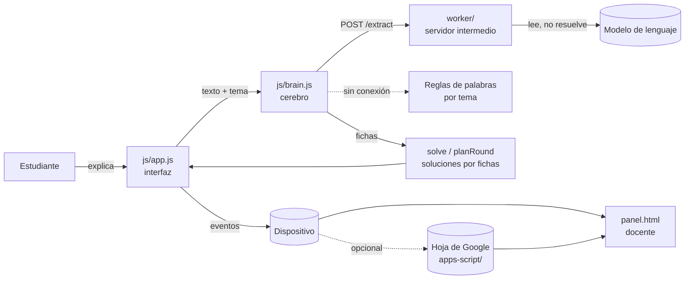

# Arquitectura

## Vista general



El juego es una página estática. No hay servidor propio salvo el opcional que lee la explicación con el modelo.

## Módulos

| Archivo | Responsabilidad | Depende de |
|---|---|---|
| `js/content.js` | Un paquete por tema: fichas, problemas con su solución correcta y su error típico, preguntas de seguimiento, reglas de palabras. `use(id)` activa un tema. | nada |
| `js/core.js` | Funciones puras: leer números, señal de originalidad, métricas por sesión, agrupación por estudiante. | nada |
| `js/brain.js` | Cerebro (fichas), solución por fichas, lectura de la explicación (servidor o reglas). | content, core |
| `js/app.js` | Interfaz del juego: escenas, estado, registro de eventos. | content, core, brain |
| `js/panel.js` | Panel docente: elegir tema y enlace, cargar datos, resumen. | content, core |
| `js/config.js` | Direcciones y opciones editables. | nada |
| `worker/` | Servidor intermedio: valida, arma el prompt por tema, llama al modelo, sanea la respuesta. | SDK de Anthropic, zod |
| `apps-script/Code.gs` | Recibe eventos y los guarda en una hoja. | nada |

`content.js`, `core.js` y `brain.js` no usan el DOM, por eso se prueban en Node (`tests/core.test.js`).

## Decisiones de diseño

**El modelo solo lee; las fichas resuelven.** Un modelo que debe «olvidar» lo que sabe tiende a resolver bien aunque el estudiante haya enseñado mal. El modelo devuelve para cada ficha un estado (bien, mal, ausente) y una cita textual. Si la cita no aparece en lo que escribió el estudiante, la ficha vuelve a ausente. Las soluciones las calculan las fichas de forma determinista: cada error se atribuye a lo que se enseñó, y nunca se enseña algo falso por accidente.

**Los errores no se generan, se eligen.** Cada problema trae su solución correcta, su solución equivocada y, a veces, una con un descuido de cálculo. Ver [contenido-de-temas.md](contenido-de-temas.md).

**Siempre hay un descuido.** Si el estudiante enseña todo bien, Chaski comete un único error de cálculo en un problema con la ficha bien. Así todos practican verificar.

**Sin aviso durante la ronda.** El juego no dice si el estudiante acertó hasta el final, para que la medición sea limpia.

**Respaldo sin conexión.** Si el servidor falla, tarda más de 12 segundos o responde algo inválido, `brain.js` lee con las reglas de palabras del tema. El juego nunca se detiene por el modelo.

**El tema se elige por enlace.** `index.html?tema=porcentajes&clase=3A`. No hay cuentas ni base de datos propia. El panel docente genera el enlace.

**Sin exámenes ni día 2.** Por decisión del equipo (30 de octubre de 2026) se quitó el examen de Chaski, el examen sin Chaski y el día 2. Consecuencia: no se mide retención ni aprendizaje, solo cómo enseñan y revisan los estudiantes.

**Servidor con lista cerrada de temas.** El tema llega desde la página, por eso el servidor solo acepta los de `worker/src/topics.ts` y nunca arma el prompt con texto del cliente. Una prueba verifica que esa lista coincida con la del juego.

## Flujo de escenas

```
welcome -> intro -> teach (2 mensajes) -> brain -> map -> ex (x6) -> probe (x4) -> reveal -> end
                          ^                                                         |
                          +------------ teach (una vez) -> brain ------------------+
```

El estado se guarda en el dispositivo en cada cambio de escena, para poder retomar con «Continuar donde me quedé».

## Eventos

Cada evento lleva `ts`, `type`, `sid` (partida), `alias`, `cls` (clase), `topic` y `day` (siempre 1, se conserva por compatibilidad).

| `type` | Cuándo | Campos principales |
|---|---|---|
| `start` | Empieza una partida | `version`, `model` |
| `teach` | El estudiante envía una explicación | `k`, `text`, `pasted`, `ms`, `orig` (señal de originalidad), `phase` |
| `brain` | Se lee una explicación | `cards` (cerebro resultante), `read` (lo que se leyó), `source` (`modelo` o `reglas`), `why`, `restatement` |
| `ex` | Se resuelve un problema | `ex`, `rule` (causa del error: `K1`..`K3`, `S` o null), `hasError`, `saidError`, `step`, `stepOk`, `correction`, `correctionOk`, `ms` |
| `probe` | Pregunta de seguimiento | `k`, `kind` (`num` o `free`), `ok`, `text`, `orig`, `pasted` |

Las métricas se calculan en `core.js` (`metricsFor`, `groupStudents`). Los eventos sin `topic` se tratan como `proporciones`.

## Pruebas

| Qué | Dónde | Cuántas |
|---|---|---|
| Contenido de los tres temas (cuentas verificadas de forma independiente), cerebro, lectura con reglas y con servidor simulado, originalidad, métricas | `tests/core.test.js` | 36 |
| Servidor: formato, temas, CORS, errores del modelo, defensa contra instrucciones escondidas, consistencia con el contenido del juego | `worker/test/worker.test.ts` | 14 |

No hay pruebas automáticas de la interfaz. Se probó a mano en el navegador, con un jugador simulado.
